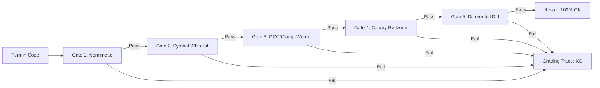

# Magrathea Architecture Specification

## 1. Overview

**Magrathea** is a lightweight, self-contained, standalone implementation of the official **42 / 1337 Coding School Evaluation and Examination Ecosystem**. It provides a fully autonomous, offline-capable environment containing the classic **ExamShell** (`examshell`), the automated continuous grader **Moulinette** (`moulinette`), the core evaluation engine **Deepthought** (`deepthought`), and official coding standard linters **Norminette** (`norminette`) and **Shnorm** (`shnorm`).

The entire repository requires zero external package managers or network dependencies. It runs directly on POSIX-compliant environments (Linux, macOS, FreeBSD).

---

## 2. Directory Structure

```text
magrathea/
├── README.md               # User onboarding guide and quickstart reference
├── Makefile                # Build and execution targets
├── install.sh              # System dependency check and ~/.local/bin symlink installer
├── examshell -> bin/examshell
├── moulinette -> bin/moulinette
├── bin/                    # First-party CLI binaries and helper tools
│   ├── moulinette          # Interactive Moulinette REPL & batch exercise grader
│   ├── examshell           # Timed ExamShell REPL simulation with Vogsphere git push
│   ├── deepthought         # Low-level 5-gate grading runner
│   ├── norminette          # 42 Norm v3 static C code analyzer
│   ├── shnorm              # 42 Shell script style & security linter
│   ├── pforge              # Pool & subject scaffolding utility
│   ├── ft_lock             # Session lock file utility
│   ├── libmemsentinel.so   # Memory allocation canary library
│   └── ...
├── bocal/                  # Cluster workstation scripts (Bocal administration)
├── core/                   # C source tree for memory sentinels & low-level test harnesses
│   ├── Makefile            # Standalone build for libmemsentinel.so & matrix runners
│   ├── include/            # Core grading C headers (moulinette_core.h)
│   └── src/                # Sandbox, memory sentinels, and diff implementations
├── deepthought/            # Core Python grading engine & UI subsystems
│   ├── compiler_and_symbols.py  # ELF nm -u symbol gate & compiler invocations
│   ├── grader.py                # 5-gate grading orchestrator
│   ├── sandbox_harness.c        # Malloc redzone canary & leak detector wrapper
│   ├── ui_theme.py              # 4-palette terminal theme engine (Cyberpunk, etc.)
│   ├── vogsphere.py             # Bare Git repository management
│   └── ...
├── docs/                   # Technical specifications
│   └── ARCHITECTURE.md     # This architecture reference
├── pools/                  # Curriculum tracks and examination definitions (YAML)
│   ├── exams/              # 9 Exam tracks (Rank 02-06, C Piscine Exam 00-02, Final)
│   └── piscine/            # 17 C Piscine modules (Shell 00 to C 13, Rush/BSQ)
├── subjects/               # 439 Canonical exercise subjects
│   ├── exams/              # 303 exam exercises
│   └── piscine/            # 136 piscine exercises (including 20 official PDFs)
├── corrections/            # Reference solutions for all 439 exercises
├── schemas/                # JSON/YAML validation schemas
├── templates/              # Pool, scale, and profile templates
├── vogsphere/              # Local bare git repository simulation
└── workspace/              # Student work area
    ├── rendu/              # Default turn-in folder for code submissions
    └── subject/            # Current exercise subject folder in ExamShell
```

---

## 3. The 5-Gate Grading Pipeline

Deepthought subjects student submissions through an unyielding 5-gate pipeline:



1. **Gate 1: Norminette (`norminette`)**:
   - Enforces the 42 C Coding Standard (4-space tabs, max 25 lines per function, max 5 functions per file, max 4 parameters, forbidden control structures like `for`, `do..while`, `switch`, `goto`).
   - Flags forbidden single-line comments (`//`), unaligned variable declarations, and missing official 42 headers.

2. **Gate 2: Symbol Whitelist (`compiler_and_symbols.py`)**:
   - Compiles an unlinked object file and executes `nm -u` to extract all external referenced symbols.
   - Enforces exact function whitelists specified in the exercise's `meta.yml` (e.g., rejecting any unauthorized call to `printf`, `malloc`, or `exit`).

3. **Gate 3: Strict Compilation (`gcc` & `clang`)**:
   - Evaluates submission against `-Wall -Wextra -Werror` using dual-compiler verification.
   - Flags unused variables, implicit function declarations, and incompatible type assignments.

4. **Gate 4: Runtime Sandbox & Canary Redzone (`sandbox_harness.c`)**:
   - Interposes memory allocations via `-Wl,--wrap=malloc` and `-Wl,--wrap=free`.
   - Surrounds heap allocations with 16-byte canary guards (pattern `0xDE, 0xAD, 0xBE, 0xEF`).
   - Detects buffer underflows, buffer overflows, double-frees, and invalid pointer releases (exit code 43).
   - Monitors active allocations at program termination to detect memory leaks (exit code 42).

5. **Gate 5: Differential Output Oracle (`grader.py`)**:
   - Compares standard output and return codes against verified reference implementations in `corrections/`.
   - Evaluates edge cases: empty strings, boundary integers (`INT_MIN`, `INT_MAX`), unaligned buffers, and malformed command-line inputs.

---

## 4. Key CLI Binaries

- **`examshell`**: Interactive terminal application replicating the authentic 42 examination environment. Manages exam timers, dynamic exercise assignments across difficulty levels, automatic folder generation in `~/rendu`, and grading via `grademe` with simulated Vogsphere Git pushes.
- **`moulinette`**: Fast, dual-mode curriculum explorer and grader. Supports direct single-exercise grading (`./bin/moulinette ft_strlen`), exercise scaffolding (`./bin/moulinette --init ft_strlen`), subject viewing (`./bin/moulinette subject ft_strlen`), and continuous file-watching (`./bin/moulinette --watch ft_strlen`).
- **`deepthought`**: Direct command-line interface to the 5-gate grader. Used for batch headless evaluations and scripted CI pipelines.
- **`norminette`**: Standalone 42 Norm compliance checker.
- **`shnorm`**: POSIX-compliant shell script style, quoting, and security auditor.
